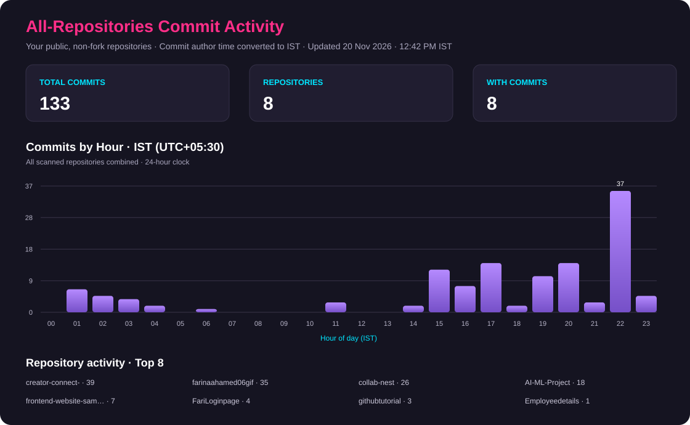

<h1 align="center">Hi 👋, I'm Farina Ahamed</h1>
<h3 align="center">Computer Science Engineering Student | Python Developer | Tech Enthusiast</h3>

I'm a first-year Computer Science Engineering student with knowledge of Python, Python Tkinter, and SQL. I also have experience creating GitHub README files and using Canva and Adobe tools for presentation design.

I have good communication and speaking skills, and I'm currently working on improving my presentation and pitching skills for hackathons. I'm eager to learn new technologies, collaborate with teams, and gain practical experience.

  

## 💻 Tech Stack

  
  
  
  
  
  
  
  
  
  

## 📊 GitHub Analytics

<picture>
  <source media="(prefers-color-scheme: dark)" srcset="./assets/overview.dark.svg" />
  
</picture>

<picture>
  <source media="(prefers-color-scheme: dark)" srcset="./assets/lifetime.dark.svg" />
  
</picture>

<picture>
  <source media="(prefers-color-scheme: dark)" srcset="./assets/contributions.dark.svg" />
  
</picture>

<picture>
  <source media="(prefers-color-scheme: dark)" srcset="./assets/languages.dark.svg" />
  
</picture>

### 📈 All-Repositories Commit Activity

  

### 📈 All-Repositories Commit Activity

  

## ✨ Beyond the Code

<table>
  <tr>
    <td width="50%" valign="top">
      <h3>🎯 What I enjoy</h3>
      
💡 Turning ideas into practical projects

      
🤝 Collaborating and learning with others

      
🏆 Taking part in hackathons

      
🎨 Exploring creative design

    </td>
    <td width="50%" valign="top">
      <h3>🚀 Currently exploring</h3>
      

        
        
      

      

        
        
      

      
Always curious. Always learning. Always building.

    </td>
  </tr>
</table>

  <i>"Turning ideas into code, one project at a time."</i>

